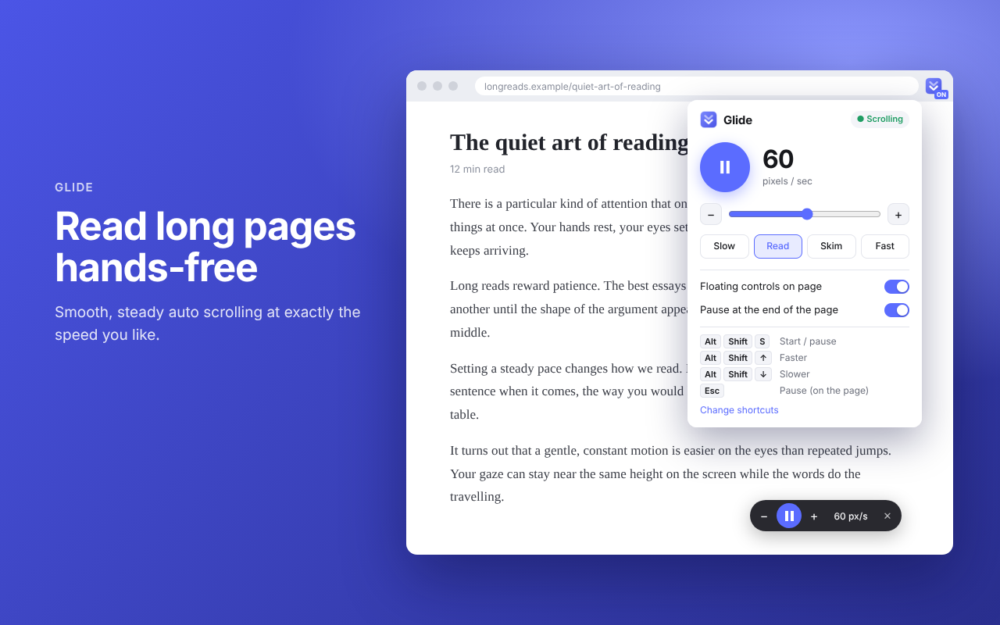

# Glide - Smooth Auto Scroll

Hands-free, adjustable auto scrolling for Chrome. It's made for long articles, docs, PDFs, notes and anything else you'd rather not keep scrolling by hand.

## Features
- Smooth, steady scrolling from 5 to 600 pixels per second
- Popup with a play/pause button, a speed slider, and Slow / Read / Skim / Fast presets
- Keyboard shortcuts: `Alt+Shift+S` start/pause, `Alt+Shift+↑/↓` speed, `Esc` pause
- Floating on-page control (optional)
- Scrolls the panel under your mouse, so it works in web apps with inner scroll areas
- Pauses itself at the end of the page (optional)
- **Glide Reader** for PDFs: Chrome's built-in PDF viewer blocks all extensions, so Glide can reopen a PDF in its own reader (built on Mozilla's pdf.js). It has zoom, page jump, and it remembers your place.
- **Auto speed (beta)**: slows down for dense text and speeds up for sparse text, short lines and gaps
- Light and dark mode
- No data collection. Three permissions at install (`activeTab`, `scripting`, `storage`), and site access only when you open a PDF in Glide Reader and choose to allow it

## Install from source
1. Download or clone this repo.
2. Open `chrome://extensions` and turn on **Developer mode**.
3. Click **Load unpacked** and select the `extension` folder.

## Project layout
| Path | What it is |
|---|---|
| `extension/manifest.json` | Extension name, permissions, icons and shortcuts |
| `extension/content.js` | Runs on the page: the scroll loop, finding the scroll target, the floating control |
| `extension/background.js` | Keyboard shortcuts and the "ON" toolbar badge |
| `extension/popup.*` | The toolbar popup |
| `extension/viewer.*` | Glide Reader, the PDF viewer |
| `extension/pdfjs/` | Mozilla pdf.js 4.10.38 (Apache 2.0), bundled unmodified |
| `extension/shared.js` | Default settings and speed limits |
| `store/` | Chrome Web Store screenshots, promo tiles and listing text |
| `PRIVACY.md` | Privacy policy |
| `PUBLISHING.md` | How to publish an update to the Chrome Web Store |

## How the smooth scrolling works
`content.js` uses `requestAnimationFrame`, which runs once per screen refresh. Each frame it moves the page by *speed × time since the last frame*. Browsers scroll in whole pixels, so leftover fractions are carried over to the next frame. That keeps very slow speeds smooth.

## How auto speed works
Every quarter second, Glide measures how much text sits in the middle band of the screen, where you're reading, as characters per pixel of height. It keeps a running average for the page you're on. When the text in the band is denser than average, Glide slows down. When it's sparser (short lines, lists, gaps, figures), Glide speeds up. It never goes below 45% or above 200% of your chosen speed, and changes ease in over about a second. Your speed setting becomes the *average* speed. In Glide Reader, it uses the PDF's own text positions. Scanned PDFs that are only images have no text to measure, so auto speed has no effect there.

## Limitations
Chrome doesn't let extensions run on `chrome://` pages, the Chrome Web Store, or its built-in PDF viewer. For PDFs, use Glide Reader instead. PDFs that need you to be signed in to a site may not open in Glide Reader.

## License
MIT. See [LICENSE](LICENSE).
